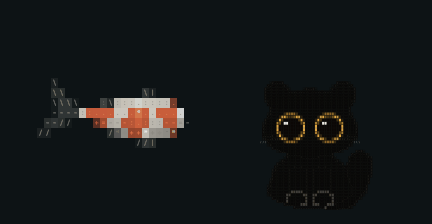

# Codex ASCII Pets

**A koi and a black cat for the Codex desktop app, drawn in text characters.** The koi is one fish from the [ASCII Koi](https://github.com/pursurer/ascii-koi) pond. The cat is the little black cat from [One Page is all you need](https://github.com/pursurer/one-page-is-all-you-need). Each is drawn by its own project's code, not redrawn by hand.

<p align="center">
  
</p>

| Pet | What you get |
|---|---|
| **ASCII Koi** | A red and white kohaku koi with the pond's spine, markings and shading. The caustic glints on its back are kept, frozen in place |
| **ASCII Cat** | A round black cat with gold-ringed eyes, built from dark tiles. It breathes, blinks slowly, trots and pounces |

## Install

```bash
git clone https://github.com/pursurer/codex-ascii-pets.git
```

```bash
mkdir -p ~/.codex/pets && cp -R codex-ascii-pets/pets/ascii-koi codex-ascii-pets/pets/ascii-cat ~/.codex/pets/
```

In Codex, open Settings, go to the pets section, press Refresh, and choose **ASCII Koi** or **ASCII Cat**.

Each pet is a folder with `pet.json` and `spritesheet.webp`: a Codex v1 atlas of 1536 × 1872 px, eight columns by nine rows of 192 × 208 px cells. The rows are idle, running right, running left, waving, jumping, failed, waiting, running (Codex is working) and review.

## How they are made

Headless Chrome runs the original drawing code and renders every cell of the atlas.

- **Koi** (`build/koi/`): `sprite.html` poses one koi, frame by frame, with a copy of the page's `pond.js` that adds a sprite mode (`opts.sprite`, 10 lines). Sprite mode draws a single koi at a fixed scale on a transparent background: no water, no shadow layer, no other fish, and the caustic glints only when asked. The code that draws the koi itself is the page's own. `pond-page.js` is the page's `pond.js` unchanged; `compare.py` draws the same pose with both, so you can see where they differ.
- **Cat** (`build/cat/`): `cat.js` is the cat's drawing code copied verbatim from One Page's `page/template.html`. A small wrapper poses the cat one frame at a time.
- `capture.py` saves the atlas and reports the margins of each row. `qa.py` makes a contact sheet and a GIF of every row on dark and light backgrounds. `preview.py` makes the GIF above.

### Rebuild

You need Google Chrome and Python 3 with Pillow.

```bash
cd build/koi && python3 capture.py 'glint=1' koi
```

```bash
cd build/cat && python3 capture.py 's=1' cat
```

Each command writes `out/<name>.png`. Save it as lossless WebP to get the shipped file, pixel for pixel:

```bash
python3 -c "from PIL import Image; Image.open('out/koi.png').save('out/koi.webp', lossless=True)"
```

Both shipped atlases were rebuilt this way on 2026-11-04 and matched the installed pets with no differing pixel.

## Credits

- Font for the cell glyphs: [Geist Mono](https://github.com/vercel/geist-font), SIL Open Font License (`build/OFL-GeistMono.txt`).

<!-- family:start -->
## The ASCII Koi family

Small things that share one look: koi drawn in text characters, letters that take a koi's colours as it swims under them, a black cat in character tiles, and black water (`#0d1315` water, `#ebe6dc` ink, `#e8784f` accent).

| Project | What it is |
|---|---|
| [ASCII Koi](https://github.com/pursurer/ascii-koi) | The pond itself: your new tab, under a clock made of the same characters. Its `pond.js` is the engine the others reuse |
| Codex Koi (coming soon) | The pond behind the Codex desktop app's new-chat page |
| [Claude Koi](https://github.com/pursurer/claude-koi) | The pond in a pane beside Claude Code, opened with `/koi` |
| **Codex ASCII Pets** (this repository) | The koi and the black cat as Codex pets |
| [One Page is all you need](https://github.com/pursurer/one-page-is-all-you-need) | Where the koi and the cat began: a one-page morning briefing that an n8n agent writes every day |

Every repository in the family has the topic [`ascii-koi`](https://github.com/topics/ascii-koi).
<!-- family:end -->

## License

MIT.
